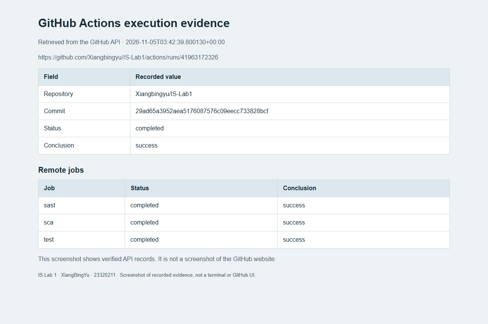

# CI execution record

Local checks passed on 5 November 2026: 43 pytest tests, Bandit with one documented false-positive suppression, and a clean audit of 13 runtime dependencies.

The remote workflow completed successfully on 5 November 2026 at approximately 11:42 China Standard Time.

- Verified run: <https://github.com/Xiangbingyu/IS-Lab1/actions/runs/41963172326>
- Tested commit: `29ad65a3952aea5176087576c09eecc733828bcf`
- Overall status: `completed`; conclusion: `success`.
- `test`: success; `sast`: success; `sca`: success.
- Artifact upload steps succeeded in all three jobs.
- Raw GitHub API record: `evidence/raw/github-actions.json`.

The image is a screenshot of a local evidence page displaying the actual GitHub API response. It is not a screenshot of the GitHub website. Later commits that add this record and screenshots do not change the tested application code.
