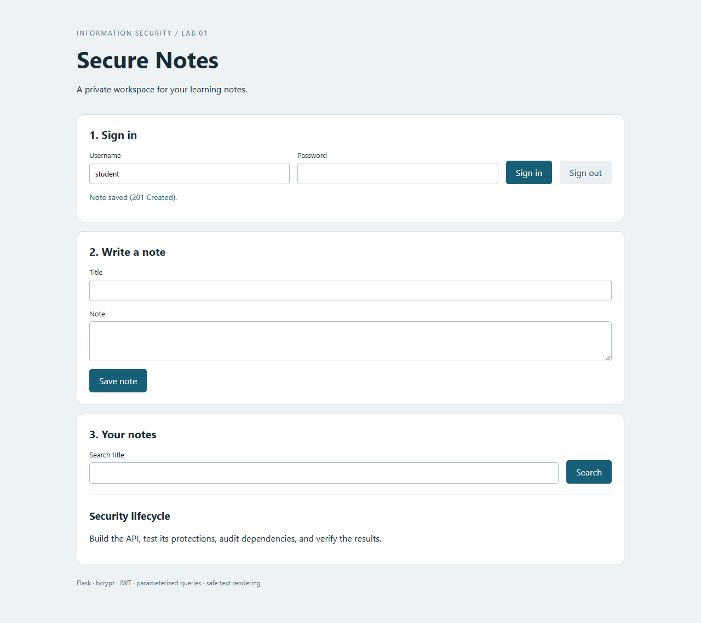
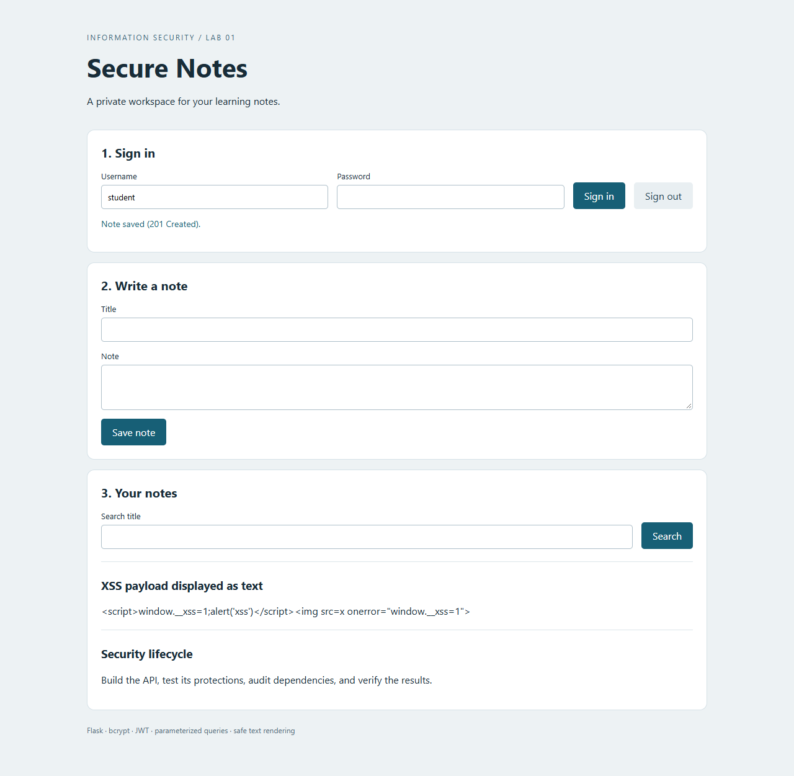
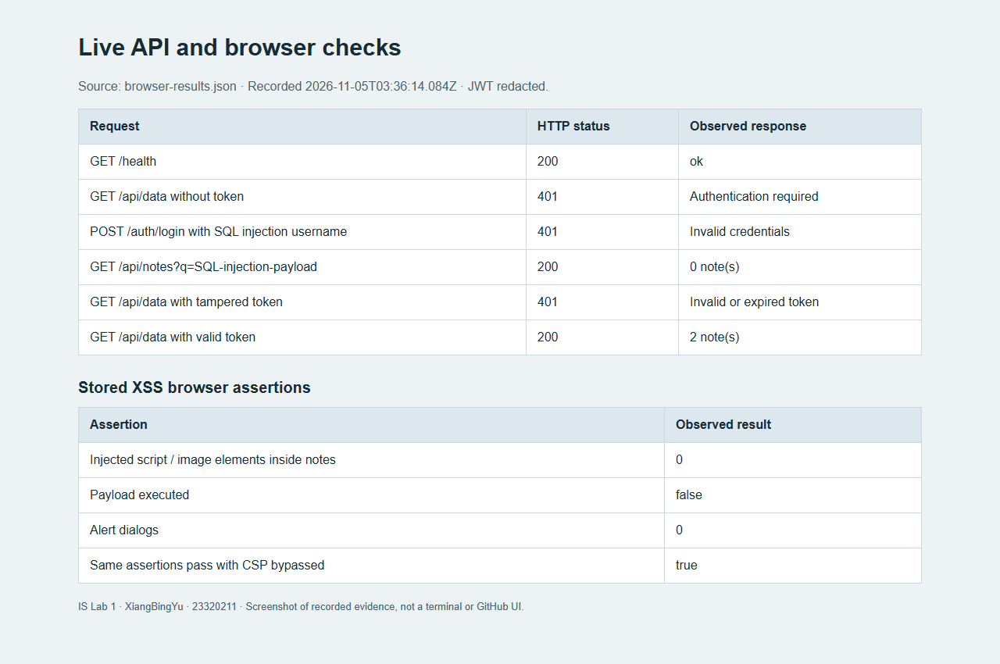
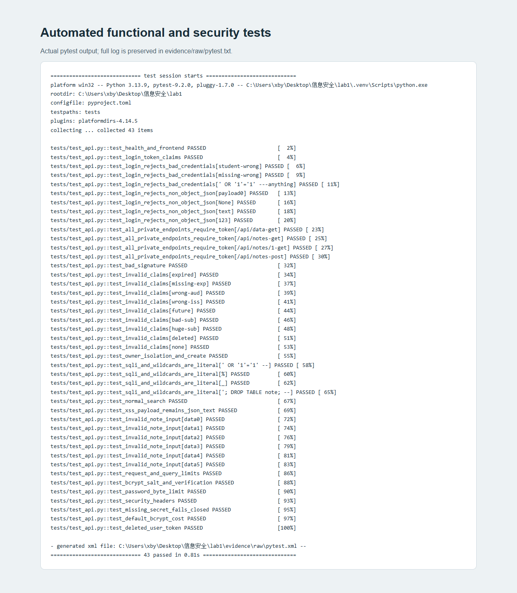
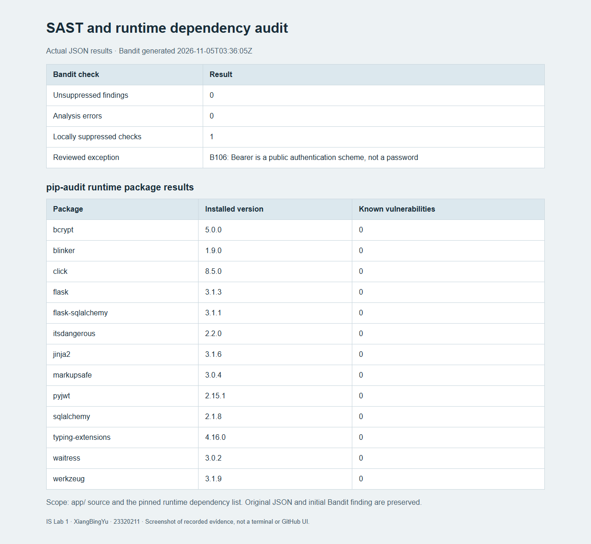
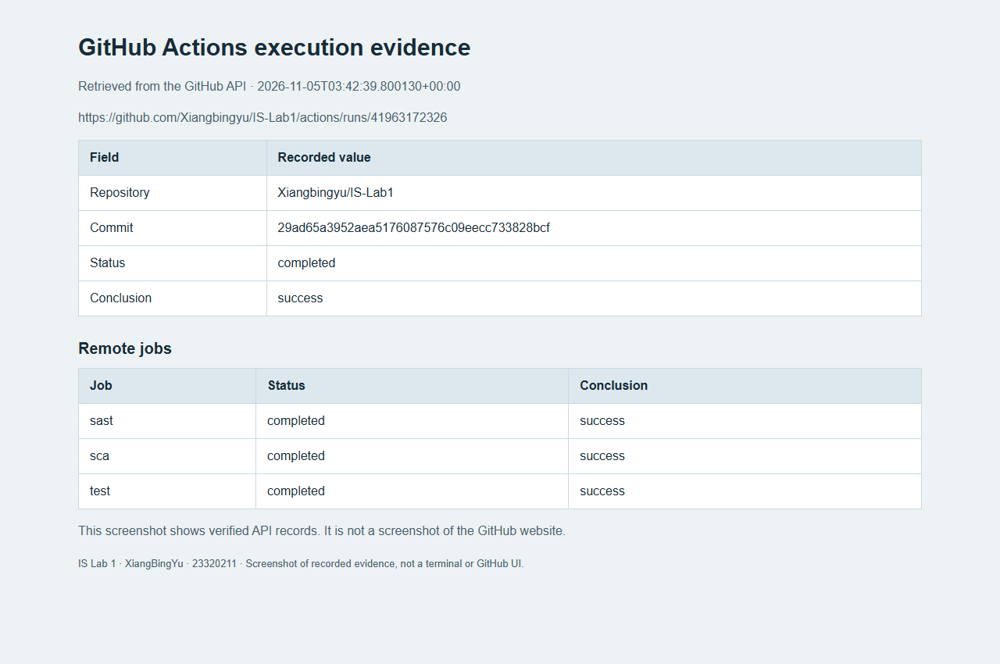

# Secure REST API Development and Automated Security Testing

HANGZHOU DIANZI UNIVERSITY

Information Security — Laboratory Work No. 1, Part I

Performed by: XiangBingYu

HDU number: 23320211

Experiment date: 5 November 2026

Repository: <https://github.com/Xiangbingyu/IS-Lab1>

## 1. Purpose of the Work

The purpose of this part of the laboratory work is to develop a REST API with security controls and verify those controls through functional tests, adversarial inputs and automated security scanning. The implemented application, Secure Notes, allows an authenticated user to create, list and search personal learning notes. Each user can access only their own notes.

The implementation combines bcrypt password hashing, JWT authentication, parameterized database operations and safe browser rendering. A GitHub Actions workflow runs functional tests, static application security testing (SAST) and software composition analysis (SCA). This report covers Part I; the separate CVE reproduction and remediation exercise belongs to Part II.

## 2. Technology Stack and Project Structure

| Component | Version or implementation |
|---|---|
| Local operating system | Windows |
| Python | 3.13.9 locally; Python 3.13 configured in CI |
| Web framework | Flask 3.1.3 |
| Database | SQLite through Flask-SQLAlchemy 3.1.1 and SQLAlchemy 2.1.8 |
| Authentication | PyJWT 2.15.1, HS256, 30-minute lifetime |
| Password hashing | bcrypt 5.0.0, cost factor 12 |
| Local HTTP server | Waitress 3.0.2, bound to 127.0.0.1 |
| Automated tests | pytest 9.2.0 |
| Static analysis | Bandit 1.9.4 |
| Dependency audit | pip-audit 2.10.1 |
| Browser evidence | Playwright-controlled Chrome |

The project separates the application factory and configuration (`app/__init__.py`), database models (`app/models.py`), authentication helpers (`app/security.py`) and endpoints (`app/routes.py`). The browser interface is stored in `app/templates/` and `app/static/`. Tests are in `tests/`, while raw evidence and screenshots are in `evidence/`. Runtime and development dependencies have separate pinned requirements files.

The application requires an external secret of at least 32 bytes and refuses to start when the secret is missing or too short. The setup instructions generate the secret using Python's `secrets` module. No real password, signing secret, database or active JWT is included in the repository.

## 3. API Description

| Endpoint | Method | Purpose | Authentication |
|---|---|---|---|
| `/auth/login` | POST | Verify credentials and issue a JWT | Public |
| `/api/data` | GET | Return the current user's notes | Required |
| `/api/notes?q=` | GET | List or search the current user's notes | Required |
| `/api/notes` | POST | Create a note with a title and body | Required |
| `/api/notes/<id>` | GET | Retrieve one note belonging to the current user | Required |
| `/health` | GET | Return a basic service health response | Public |

The login body contains `username` and `password`. A successful response contains `access_token`, `token_type` and `expires_in`. Protected requests carry the token in the `Authorization: Bearer <token>` header. Creating a note returns HTTP 201. Missing or invalid authentication returns HTTP 401. A note owned by another user returns HTTP 404, matching the response for a nonexistent note.

Note titles are limited to 120 characters and bodies to 4,000 characters. Searches are limited to 100 characters, requests to 16 KiB, and list responses to the most recent 100 matching notes. Passwords are provisioned through an interactive CLI command rather than a public registration endpoint.



## 4. Implemented Security Measures

### 4.1 SQL Injection Protection

All application database operations use SQLAlchemy expressions with bound values. User input is not concatenated into raw SQL. The login query compares `User.username` to the submitted username through an ORM expression. The search query combines an owner restriction with a title condition:

```python
statement = db.select(Note).where(Note.owner_id == g.user.id)
statement = statement.where(Note.title.contains(query, autoescape=True))
```

Binding keeps input separate from SQL syntax. The `autoescape=True` option additionally treats SQL LIKE wildcard characters, including `%` and `_`, literally; this is a search-behavior safeguard rather than a replacement for parameter binding. Injection-style search input returned an empty result instead of expanding access. A login attempt using an injection-style username returned HTTP 401.

### 4.2 Cross-Site Scripting Protection

The JSON API returns note content as text data with the `application/json` content type. It does not claim that JSON serialization automatically makes content safe for arbitrary HTML insertion. The browser client creates DOM elements and assigns untrusted titles and bodies using `textContent`:

```javascript
heading.textContent = note.title;
body.textContent = note.body;
```

The client does not use `innerHTML` for note content. The application also sends `X-Content-Type-Options: nosniff` and a Content Security Policy allowing scripts only from the same origin, without inline scripts. The template is rendered through Flask's Jinja environment.

The browser experiment stored a note containing both a script element and an image with an event handler. The payload remained visible as literal text. Automated browser assertions found no script or image elements created inside the notes container, no marker variable set by the payload and no alert dialogs. A separate browser context with CSP bypassed produced the same result, demonstrating that safe DOM insertion itself blocked execution in this interface.



### 4.3 Password Storage and Authentication

Passwords are stored as bcrypt hashes with a random salt and a cost factor of 12. Hashes for the same password differ because each hash has its own salt. Authentication uses `bcrypt.checkpw`; the original password is not stored. The application rejects passwords outside bcrypt's selected 12–72 UTF-8 byte policy instead of silently truncating them.

Successful login issues an HS256 JWT containing `sub`, `iat`, `nbf`, `exp`, `iss` and `aud`. Verification fixes the accepted algorithm to HS256, requires the relevant claims, validates the signature and registered claims, and confirms that the subject identifies an existing user. The token expires after 1,800 seconds. An unknown account and an incorrect password produce the same error. For well-formed requests, the unknown-account path also checks a dummy bcrypt hash to reduce an obvious timing difference; this is not a claim of perfectly constant response time.

The browser stores the token in memory. Refreshing the page or signing out clears that local token. This implementation does not maintain a token revocation list, so a previously copied valid token remains valid until expiry or signing-key replacement.

### 4.4 Access Control and Input Validation

Every `/api/` endpoint requires a valid token. Note queries include the authenticated user's ID, and the server sets note ownership itself. A submitted `owner_id` cannot create a note for another user. A test confirms that a user's valid token cannot retrieve another user's note.

The service validates JSON object shapes, string types and input lengths. Very large request bodies receive HTTP 413. Authentication responses and other application responses include `Cache-Control: no-store`; framing is denied through both response headers and CSP.

## 5. Functional and Security Testing

The local automated suite completed with **43 tests passed**. It covers normal login, note creation and search, missing credentials, modified signatures, expired tokens, missing claims, incorrect issuers and audiences, future validity times, unsigned tokens, deleted users, cross-user access, injection payloads, literal wildcard handling, malformed JSON, oversized inputs and bcrypt behavior.

Most isolated tests use bcrypt cost 4 to keep execution fast. A separate test checks that the application's default hash uses cost 12. The live demonstration also uses the default cost 12. The pytest XSS test checks JSON behavior; the separate browser experiment checks actual DOM rendering and execution.

| Live HTTP check | Observed result |
|---|---|
| Health endpoint | 200, status `ok` |
| Data endpoint without a token | 401 |
| Login with an SQL injection username | 401 |
| Note search with an SQL injection string | 200, empty notes array |
| Data endpoint with a tampered token | 401 |
| Data endpoint with a valid token | 200, the current user's notes |





Figures 3–5 are screenshots of evidence pages generated from actual HTTP responses and tool output, rather than screenshots of a terminal window. The original records remain available as `browser-results.json`, `pytest.txt`, `pytest.xml`, `bandit.json` and `pip-audit.json` under `evidence/raw/`.

## 6. Continuous Integration and Security Scanning

The workflow `.github/workflows/ci.yml` defines three independent jobs: `test`, `sast` and `sca`. It runs on pushes, pull requests and manual dispatches using a Python 3.13 Linux runner. Reports are uploaded as artifacts even if a check fails. A failed scanner or test command fails its job; the workflow does not hide failures with `continue-on-error`.

### 6.1 Static Application Security Testing

Bandit scans the Python application directory. The initial run reported one low-severity B106 finding for `token_type="Bearer"`. Manual inspection showed that `Bearer` is the public authentication scheme name, not a password or signing secret. The final code contains a local `# nosec B106` on that response construction, with its reason documented immediately above it. No rule is disabled globally.

The repeated scan completed successfully with **zero unsuppressed findings and one reviewed rule suppression**. The original finding is preserved in `evidence/raw/bandit-initial.json`. This result demonstrates review of a scanner finding; it is not presented as a repaired exploitable vulnerability. Bandit also emits a benign diagnostic for the nested call on the annotated line; its JSON result reports no analysis errors.

### 6.2 Software Composition Analysis

pip-audit scanned the **13 pinned runtime packages** in `requirements.txt`, including transitive dependencies. The final local result on 5 November 2026 was **no known vulnerabilities found**. No vulnerable-dependency remediation cycle is claimed because this project's recorded scan did not identify a vulnerable runtime package.

The audit uses `--disable-pip --no-deps` against the explicit pinned runtime list. These options prevent additional dependency resolution during the audit; they do not make an incomplete requirements file complete. The development tools and the operating system are outside this scan's scope. The scanner recommends hash-locking dependencies as an additional supply-chain measure; the current files pin versions but do not include distribution hashes.



### 6.3 GitHub Actions Execution

The configured workflow provides continuous integration and security checks. It does not deploy the application to a public service. The [verified GitHub Actions run](https://github.com/Xiangbingyu/IS-Lab1/actions/runs/41963172326) completed successfully on 5 November 2026: all three jobs (`test`, `sast` and `sca`) passed and uploaded their artifacts. The tested commit was `29ad65a3952aea5176087576c09eecc733828bcf`. Details and source records are provided in the companion [CI execution record](CI_RUN.md).



Figure 6 is an evidence-page screenshot of verified API records, not a screenshot of the GitHub website.

## 7. Answers to Relevant Control Questions

### Why use bcrypt rather than plain SHA-256 for passwords?

SHA-256 is designed to be fast, making large-scale password guessing inexpensive compared with a dedicated password-hashing function. bcrypt adds a random salt and a configurable computational cost. This slows offline guessing and prevents equal passwords from producing equal stored hashes. Strong passwords remain necessary; hashing does not make weak passwords impossible to guess.

### What is the difference between SAST and DAST?

SAST examines source code without running the application. Bandit is the SAST tool in this project. DAST interacts with a running service and observes its external behavior. The live API and browser checks here are targeted dynamic tests; a full DAST scanner such as OWASP ZAP was not run. SCA is separate: it checks third-party packages against known vulnerability information.

### How does JWT authentication work?

A signed JWT contains a header, a payload and a signature. The client sends the token with later requests. This server accepts only HS256, verifies the signature using its secret key, validates required claims and checks the user record. Signing provides integrity, not confidentiality: the header and payload can be decoded without the secret. Passwords are therefore never included in the payload.

### What happens if third-party dependencies are not audited?

An application can inherit known vulnerabilities from direct or transitive packages even if its own code appears correct. SCA helps identify affected installed versions. A clean scan only describes the selected packages and the advisories known at that time, so dependency auditing must be repeated.

### Why is regression testing necessary after security changes?

A security change can alter legitimate behavior while blocking an attack. Regression testing checks both outcomes: unauthorized requests should fail, while permitted login, note creation and search should still succeed. This project keeps both types of checks in the automated suite.

## 8. Conclusion and Limitations

Secure Notes demonstrates authentication, password hashing, parameterized queries, safe browser rendering and per-user authorization in a small Flask application. The local suite passed 43 tests, browser checks confirmed that the stored payload remained inert in the implemented interface, and the security scans completed within their stated scopes.

Further work before public deployment would include HTTPS termination, login rate limiting, managed secret rotation, token revocation, security logging and broader security testing. The application is bound to the local loopback interface for this experiment. Completing Part II will require a separate CVE selection, controlled reproduction, root-cause analysis, remediation and regression evidence.

## References

- Flask security guidance: <https://flask.palletsprojects.com/en/stable/web-security/>
- PyJWT verification API: <https://pyjwt.readthedocs.io/en/stable/api.html>
- Bandit B106 rule explanation: <https://bandit.readthedocs.io/en/1.9.4/plugins/b106_hardcoded_password_funcarg.html>
- Project source and reproducible evidence: <https://github.com/Xiangbingyu/IS-Lab1>
